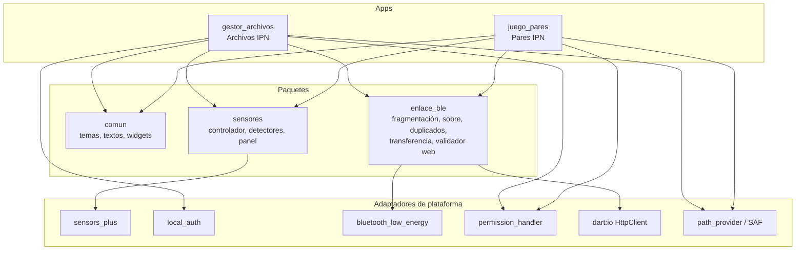
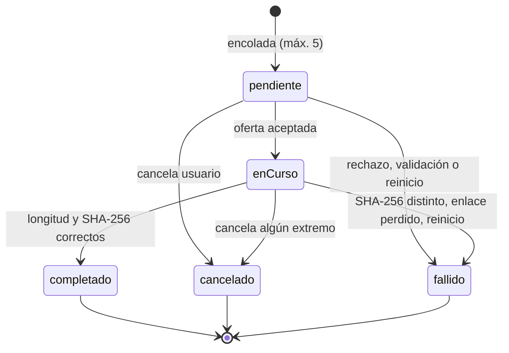
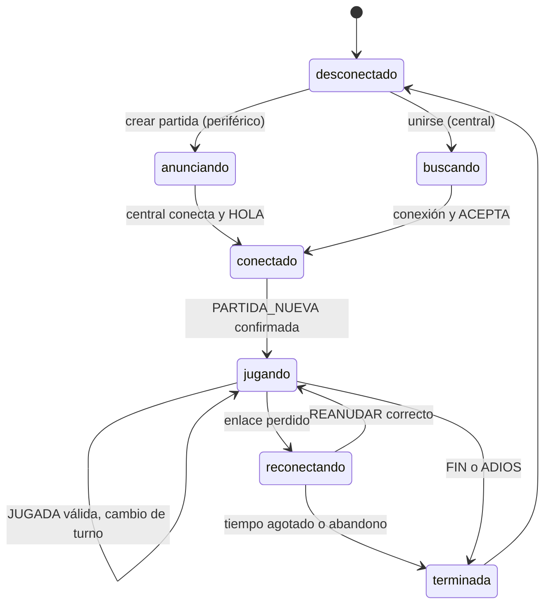

# Arquitectura — Práctica 6

## 1. Componentes

`HttpClient` solo lo usa el dispositivo A en la consulta web. `sensors_plus`, `bluetooth_low_energy` y `local_auth` quedan detrás de interfaces (`FuenteSensor`, `TransporteBytes`, servicio de autenticación) para sustituirlos por simulados o en memoria en las pruebas.

## 2. Capas

| Capa | Contenido | Dependencia de plataforma |
|---|---|---|
| Datos | Adaptadores (sensors_plus, BLE, HttpClient, archivos, historial JSON, caché web) | Sí |
| Dominio | Detectores de gestos, `Enlace`, `ControlDuplicados`, `Reensamblador`, motor de transferencia, validador web, reglas del juego | No (Dart puro, probable sin dispositivo) |
| Presentación | Pantallas, `Provider`/`ChangeNotifier`, insignias, diálogos de permiso | Flutter |

## 3. Máquinas de estado

### 3.1 Transferencia

Un reinicio convierte `pendiente` y `enCurso` huérfanos en `fallido` («interrumpida por reinicio»). Nunca se marca `completado` sin verificación.

### 3.2 Sesión de juego en red

## 4. Ciclo de vida

- Solo en **primer plano**: no hay servicios en segundo plano ni trabajo permanente.
- `AppLifecycleState.paused/inactive/hidden`: las suscripciones de sensores se cancelan y se registra «pausa»; al volver a `resumed` se reanudan y se registra «reanuda».
- Salir de la pantalla de sensores cancela las suscripciones (`dispose`).
- BLE en segundo plano: una sesión activa puede perderse; se informa al volver y se ofrece reconectar (juego) o se marca `fallido` (archivos).
- Avisos: **notificaciones locales** (fin de transferencia con la app abierta o recién minimizada); no se usa FCM ni Firebase.
- El estado de partida y el historial de transferencias se persisten para reanudar o informar fin tras reinicio.

## 5. Permisos

| Rol / función | Android 12+ (API 31+) | Android ≤ 11 (API ≤ 30) | iOS |
|---|---|---|---|
| Escanear (central) | `BLUETOOTH_SCAN` con `neverForLocation` | `BLUETOOTH`, `BLUETOOTH_ADMIN` (≤ 30) y ubicación (necesaria para escanear en ≤ 30) | `NSBluetoothAlwaysUsageDescription` |
| Conectar (central) | `BLUETOOTH_CONNECT` | `BLUETOOTH` | igual |
| Anunciar (periférico) | `BLUETOOTH_ADVERTISE` y `BLUETOOTH_CONNECT` | `BLUETOOTH`, `BLUETOOTH_ADMIN` | igual |
| Sensores de movimiento | Ninguno (muestreo ≤ 200 Hz sin permiso) | Ninguno | `NSMotionUsageDescription` (solo para movimiento de CoreMotion; el simulador no tiene sensores) |
| Biometría | `USE_BIOMETRIC` | `USE_FINGERPRINT`/`USE_BIOMETRIC` | `NSFaceIDUsageDescription` |
| Consulta web (A) | `INTERNET` (el B no la usa) | `INTERNET` | — |
| Notificaciones locales | `POST_NOTIFICATIONS` (13+) | — | permiso de notificaciones en tiempo de ejecución |

- Ubicación: solo en Android ≤ 11, porque el sistema la exige para escanear BLE; en 12+ se declara `neverForLocation` y no se pide.
- No se solicita ubicación en segundo plano, almacenamiento amplio ni servicios en primer plano permanentes.
- Frase de iOS (propósito): «Se usa Bluetooth para jugar y transferir archivos con otro dispositivo cercano».
- Los permisos se piden en contexto (al pulsar la acción), con explicación previa y manejo de denegado, permanente y revocado.

## 6. Seguridad

- **SHA-256 detecta alteración o corrupción, no autentica** al emisor; un atacante en el enlace podría enviar archivo y hash coherentes.
- El cifrado del enlace BLE existe solo si los dispositivos están **emparejados (bonded)** a nivel del sistema; el servicio GATT propio no exige emparejamiento. No se implementa criptografía propia.
- El usuario acepta explícitamente cada archivo recibido; el destino es siempre el espacio privado (`recibidos/`), con temporal privado y verificación antes de renombrar.
- Consulta web: A es un proxy restringido: lista blanca, solo HTTPS 443, sin credenciales en URL, sin IP literal, DNS verificado contra loopback/privadas/link-local, redirecciones revalidadas, tipos y tamaños limitados. Reduce, no elimina, el riesgo de SSRF.
- Biometría: solo decide si se ejecuta la acción; no cifra archivos ni entrega datos biométricos.
- Las simulaciones y modos de alteración (bloque alterado, duplicado, fuera de turno) están en Ajustes → Diagnóstico.

## 7. Límites y justificación

| Límite | Valor | Razón |
|---|---|---|
| Archivo | 512 KiB | Didáctico: ≈256 bloques de 2 KiB; BLE ofrece decenas de KB/s, así que el máximo ronda decenas de segundos |
| Bloque | 2 KiB | Cabe en pocos fragmentos aun con MTU bajo; limita el costo de reintentar |
| Mensaje reensamblado | 64 KiB | Evita consumo de memoria por mensajes malformados |
| Cola | 5 | Acota estado y memoria |
| Web: cuerpo | 256 KiB; imagen ≤ 64 KiB | Tiempo razonable por BLE |
| Web: tiempo / frecuencia | 10 s / 10 por minuto | Evita abuso de A como proxy |
