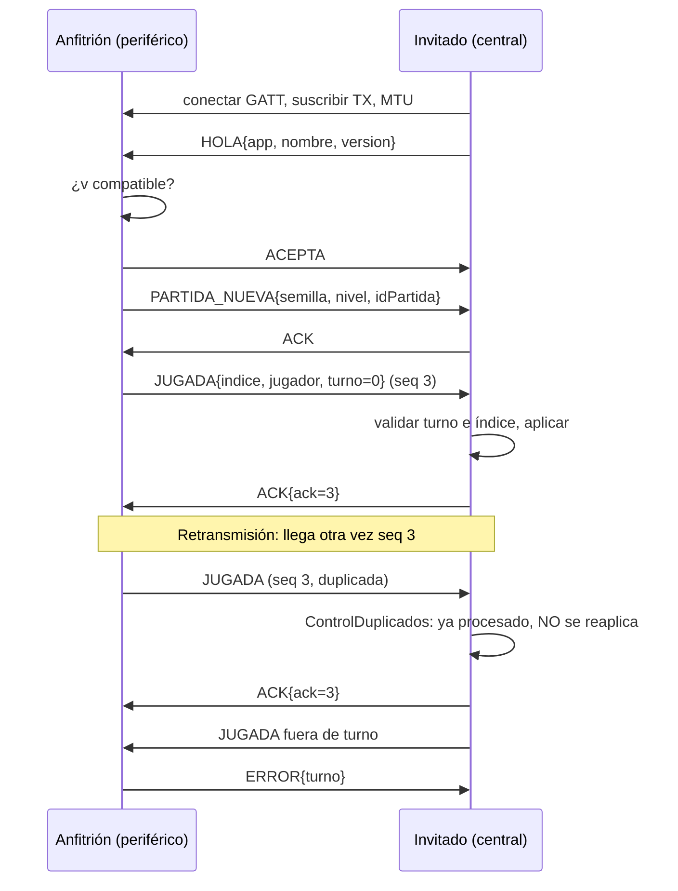
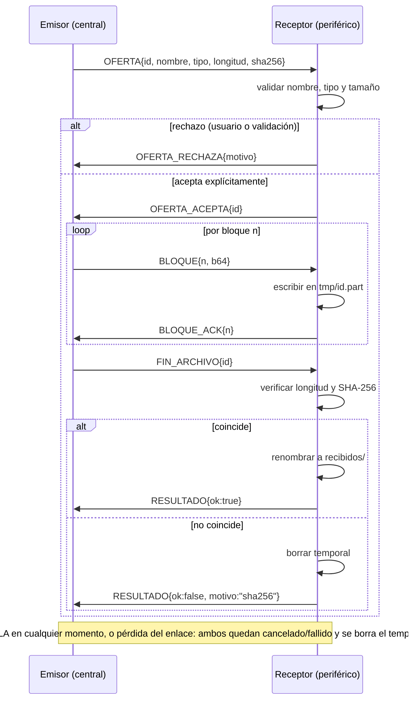
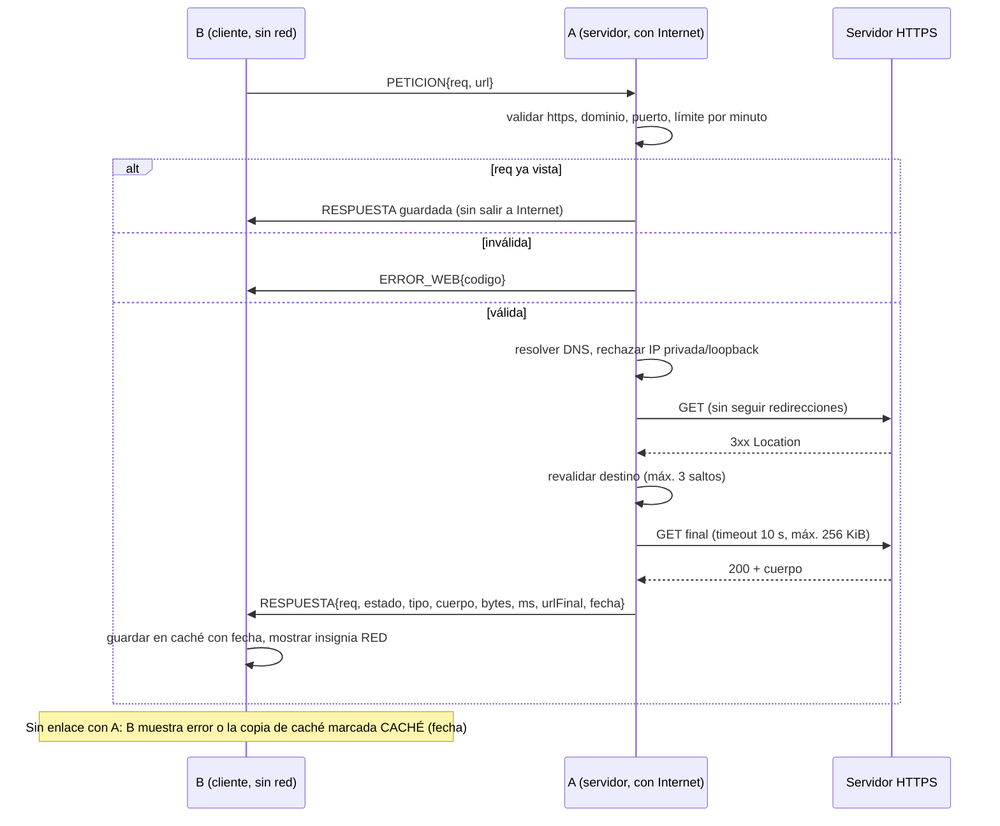

# Contrato de protocolo — Práctica 6

Fuente de verdad: `docs/diseno-p6.md` y el paquete `packages/enlace_ble`. Si el
código cambia, se actualiza aquí. Versión de protocolo vigente: **1**.

## 1. Capas

| Capa | Contenido |
|---|---|
| 0 Transporte | BLE GATT (`ClienteBle` / `ServidorBle`) o `TransporteMemoria` en pruebas |
| 1 Fragmentación | Cabecera de 5 bytes + carga; `Reensamblador` |
| 2 Sobre | JSON UTF-8 con versión, canal, sesión, secuencia, tipo y datos |
| 3 Aplicación | Canales `juego`, `archivos`, `web`, `control` |

## 2. GATT

| Elemento | UUID | Propiedades | Dirección |
|---|---|---|---|
| Servicio | `6f1c0001-9b5a-4c1e-8f7e-0c0ffee00006` | — | — |
| RX | `6f1c0002-9b5a-4c1e-8f7e-0c0ffee00006` | write, write without response | central → periférico |
| TX | `6f1c0003-9b5a-4c1e-8f7e-0c0ffee00006` | notify (CCCD) | periférico → central |

- Anuncio: el UUID de servicio va en ambas plataformas; el central filtra el escaneo por ese UUID. Lo demás depende del sistema (ver 2.1).
- Roles: **periférico** = anfitrión/receptor/servidor web (anuncia y acepta un central); **central** = invitado/emisor/cliente web (escanea y conecta). Una sola conexión a la vez.
- MTU: el central solicita 512 y lee `maximumWriteLength`; el periférico usa `getMaximumNotifyLength(central)`. No hay tamaño universal: **fragmento útil = longitud máxima negociada − 5**.

### 2.1 Datos del anuncio

| Plataforma del anfitrión | Contenido del anuncio |
|---|---|
| Android | UUID de servicio de 128 bits + **datos de fabricante** con id `0xFFFF` (reservado para pruebas por el Bluetooth SIG) y 5 bytes: `'P'` (0x50), `'6'` (0x36), código de app (`1` juego, `2` archivos, `3` web) y un sufijo de 2 bytes (big endian). **No se anuncia nombre local.** |
| iOS | UUID de servicio + nombre local `P6-<app>-<4 hex>` (el sufijo en hexadecimal) |

- En Android el plugin `bluetooth_low_energy` implementa el nombre local con `BluetoothAdapter.setName()`, que renombra el teléfono completo; además 3 B (flags) + 18 B (UUID) + 9 B (fabricante) = 30 B caben en los 31 B del paquete de anuncio y el nombre no.
- El central construye el nombre visible `P6-<app>-<4 hex>` a partir de los datos de fabricante (Android) o lee el nombre local (iOS). Un anuncio sin los bytes `'P','6'` se ignora.
- Esta combinación no se ha verificado entre sistemas distintos (ver el README, matriz de pares).

## 3. Cabecera de fragmento

```text
byte:   0        1  2        3  4        5 ...
      +-------+---------+---------+----------------+
      | flags | msgId   | indice  | carga (JSON)   |
      | 1 B   | 2 B BE  | 2 B BE  | ≤ maxFrag − 5  |
      +-------+---------+---------+----------------+
flags: bit0 = 1 último fragmento; bits1-7 = 0 (reservados)
```

- `msgId` identifica el mensaje lógico; `indice` empieza en 0 y es consecutivo.
- `Reensamblador`: agrupa por `msgId`, exige índices consecutivos, descarta un mensaje incompleto a los 10 s y limita el mensaje a 64 KiB.

## 4. Sobre (JSON)

```json
{"v":1,"canal":"juego","sesion":"a1b2c3d4","seq":17,"tipo":"JUGADA","ack":null,"datos":{}}
```

| Campo | Tipo | Regla |
|---|---|---|
| `v` | int | Versión de protocolo; si difiere se responde `ERROR{version}` y se ignora |
| `canal` | string | `juego`, `archivos`, `web`, `control` |
| `sesion` | string | 8 hex; id de partida, transferencia o sesión web |
| `seq` | int | Creciente por emisor y sesión |
| `tipo` | string | Ver catálogo |
| `ack` | int/null | `seq` confirmado (solo en `ACK`) |
| `datos` | objeto | Específico del tipo |

### 4.1 Tipos comunes (`control`)

| Tipo | Datos | Ejemplo |
|---|---|---|
| `HOLA` | `app, nombre, version` | `{"app":"juego","nombre":"T1","version":1}` |
| `ACEPTA` | — | `{}` |
| `RECHAZA` | `motivo` | `{"motivo":"ocupado"}` |
| `ACK` | — (usa `ack`) | `{"v":1,"canal":"control","sesion":"a1b2c3d4","seq":5,"tipo":"ACK","ack":17,"datos":{}}` |
| `PING` | — | `{}` |
| `ADIOS` | `motivo` | `{"motivo":"abandono"}` |
| `ERROR` | `codigo, mensaje` | `{"codigo":"turno","mensaje":"No es tu turno"}` |

### 4.2 Juego (`canal: juego`)

| Tipo | Datos | Ejemplo |
|---|---|---|
| `PARTIDA_NUEVA` | `semilla, nivel, anfitrionEmpieza, idPartida` | `{"semilla":48213,"nivel":"4x4","anfitrionEmpieza":true,"idPartida":"a1b2c3d4"}` |
| `JUGADA` | `indice, jugador, turno` | `{"indice":7,"jugador":"anfitrion","turno":3}` |
| `ESTADO` | `snapshot` | `{"snapshot":{"turno":4,"puntos":{"anfitrion":2,"invitado":1},"reveladas":[7,2]}}` |
| `REANUDAR` | `idPartida, ultimoSeq` | `{"idPartida":"a1b2c3d4","ultimoSeq":17}` |
| `FIN` | `ganador, puntos` | `{"ganador":"anfitrion","puntos":{"anfitrion":8,"invitado":6}}` |

Validación de `JUGADA`: `jugador` corresponde al turno, `turno` coincide con el contador local, `indice` en rango y carta no emparejada ni ya revelada. Si falla: `ERROR{codigo:"turno"|"jugada"}` y el estado no cambia.

### 4.3 Archivos (`canal: archivos`)

| Tipo | Datos | Ejemplo |
|---|---|---|
| `OFERTA` | `id, nombre, tipo, longitud, sha256, bloque` | `{"id":"f1e2d3c4","nombre":"datos.json","tipo":"json","longitud":1432,"sha256":"9f86d0…0a08","bloque":2048}` |
| `OFERTA_ACEPTA` | `id` | `{"id":"f1e2d3c4"}` |
| `OFERTA_RECHAZA` | `id, motivo` | `{"id":"f1e2d3c4","motivo":"usuario"}` |
| `BLOQUE` | `id, n, b64` | `{"id":"f1e2d3c4","n":0,"b64":"eyJhIjox…"}` |
| `BLOQUE_ACK` | `id, n` | `{"id":"f1e2d3c4","n":0}` |
| `CANCELA` | `id, motivo` | `{"id":"f1e2d3c4","motivo":"usuario"}` |
| `FIN_ARCHIVO` | `id` | `{"id":"f1e2d3c4"}` |
| `RESULTADO` | `id, ok, motivo` | `{"id":"f1e2d3c4","ok":false,"motivo":"sha256"}` |

Reglas: tipos `txt json xml jpg` (`.jpeg` → `jpg`); `longitud` ≤ 512 KiB; bloque de 2 KiB de datos en base64; nombre saneado (`[A-Za-z0-9._ -áéíóúñÁÉÍÓÚÑ]`, sin `/ \ ..`, máx. 80, extensión coherente con el tipo).

### 4.4 Web (`canal: web`)

| Tipo | Datos | Ejemplo |
|---|---|---|
| `PETICION` | `req, url` | `{"req":"r0001a","url":"https://jsonplaceholder.typicode.com/todos/1"}` |
| `RESPUESTA` | `req, estado, tipo, cuerpo` o `b64`, `bytes, ms, urlFinal, fecha` | `{"req":"r0001a","estado":200,"tipo":"application/json","cuerpo":"{…}","bytes":83,"ms":412,"urlFinal":"https://jsonplaceholder.typicode.com/todos/1","fecha":"2026-11-12T10:15:00Z"}` |
| `ERROR_WEB` | `req, codigo, mensaje` | `{"req":"r0001a","codigo":"destino_rechazado","motivo":"dominio","mensaje":"Destino no permitido."}` |

Lista blanca de dominios (puerto 443): `jsonplaceholder.typicode.com`, `httpbin.org`, `api.github.com`, `www.ipn.mx`. Recursos de prueba: ver `docs/diseno-p6.md`.

## 5. Diagramas de secuencia

### 5.1 Sesión de juego: inicio, jugada y duplicado



### 5.2 Transferencia de archivo (éxito y fallo)



### 5.3 Consulta web: A con Internet, B solo Bluetooth



## 6. Versionado

- `v` entero único para todo el protocolo. Cambios compatibles (campos nuevos opcionales en `datos`) no incrementan `v`; los receptores ignoran campos desconocidos.
- Cambios incompatibles incrementan `v`. Un extremo que recibe `v` distinto responde `ERROR{codigo:"version"}` y no procesa el mensaje.
- `HOLA.version` informa lo que el extremo soporta; la sesión usa el mínimo común si es ≥ 1, de lo contrario se cierra.

## 7. Control de duplicados

- Cada emisor numera `seq` por sesión. El receptor guarda los `seq` procesados (ventana acotada) por emisor y sesión.
- Si llega un `seq` ya procesado: **no** se reaplica el efecto (jugada, bloque, petición) y se reenvía el `ACK`.
- En web además se guarda `req → respuesta`; una `req` repetida devuelve la respuesta guardada sin nueva salida a Internet.
- En archivos, un `BLOQUE` repetido se confirma con `BLOQUE_ACK` sin reescribirse.

## 8. Tiempos y reintentos

| Mecanismo | Valor |
|---|---|
| Espera de `ACK` | 3 s |
| Reintentos por mensaje confiable | 3, luego error de enlace |
| Reensamblado incompleto | descartado a los 10 s |
| Mensaje máximo reensamblado | 64 KiB |
| Bloque de archivo | 2 KiB de datos (≈2.7 KiB en base64, fragmentado según MTU) |
| Petición web | timeout 10 s, 256 KiB máx., 3 redirecciones, 10 peticiones/min |

Pérdida del enlace: no hay reanudación de archivos (queda `fallido`); en juego se permite `REANUDAR{idPartida, ultimoSeq}`.

## 9. Códigos de error

| Código | Canal | Significado |
|---|---|---|
| `version` | todos | Versión de protocolo no soportada |
| `formato` | todos | Sobre/JSON mal formado o campo faltante |
| `turno` | juego | Jugada fuera de turno |
| `jugada` | juego | Índice inválido o carta ya resuelta |
| `sesion` | todos | Sesión desconocida o terminada |
| `ocupado` | todos | Ya hay una sesión activa |
| `nombre` | archivos | Nombre lógico no permitido |
| `tipo` | archivos | Tipo/extensión no permitido |
| `tamano` | archivos | Excede el límite |
| `sha256` | archivos | Integridad fallida |
| `cancelado` | archivos | Cancelado por un extremo |
| `destino_rechazado` | web | Falló una regla de validación. Campo extra `motivo`: `urlInvalida`, `esquema`, `credenciales`, `ipLiteral`, `dominio`, `puerto`, `destinoPrivado` (IP privada, loopback o link-local) o `demasiadasRedirecciones` |
| `limite` | web | Más de 10 peticiones por minuto |
| `timeout` | web | Más de 10 s |
| `sin_internet` | web | A no tiene Internet (incluye fallo de DNS) |
| `demasiado_grande` | web | Más de 256 KiB o no cabe en un mensaje reensamblado de 64 KiB |
| `formato_no_admitido` | web | Tipo de contenido no admitido |
| `formato` | web | Petición mal formada |
| `red` | web | Otro fallo de red o TLS en A |

Los códigos web coinciden con `packages/consulta_web/lib/src/dominio/codigos_web.dart`. `tamano` aplica solo al canal `archivos`.
